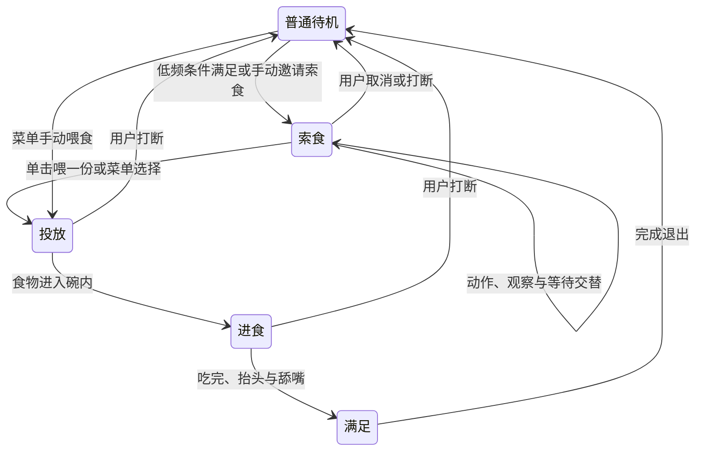

# 安安趣味互动设计草案

状态：需求已记录，声音偏好已确认；其余具体交互、时间参数及首批边界属于建议方案，等待用户评审。本轮仅编写资料，不表示已获新玩法编码或发布批准。拟作为下一功能版本，版本号在实施时统一确定，不修改现有 1.2.0。

依据：[玩法调研](../../趣味玩法调研.md)、[当前行为设计](../../行为设计.md)、用户 2026 年 10 月 28 日需求及声音选择。

## 用户要求与建议的区分

| 编号 | 用户明确提出的要求 | 本草案的落实建议 |
|---|---|---|
| R1 | 召唤逗猫棒逗安安 | 右键与托盘菜单提供“召唤逗猫棒／收起逗猫棒” |
| R2 | 不定时肚子饿，喵喵喵并有动画特效 | 清醒可见时低频索食，张嘴、歪头、抬爪与气泡、音符结合 |
| R3 | 未被用户打断时持续长一点，类似一直撒娇 | 索食会话不自动结束；前期明显撒娇，之后轻量等待，持续到喂食或取消 |
| R4 | 用户交互后给零食或冻干 | 索食时单击喂默认冻干；菜单允许明确选择两种食物 |
| R5 | 在猫碗里面吃 | 碗内投放、低头进食、食物减少、舔嘴满足，形成完整过程 |
| R6 | 可以设计交互、借鉴其他桌宠并考虑更多玩法 | 情境点击保留老规则；摸摸、小球、纸箱列为候选，不扩大首批 |
| R7 | 保存执行计划，避免中断遗忘 | 保存调研、设计、逐步任务和独立续接入口，任务完成后记录真实证据 |
| R8 | 动画气泡为主，声音默认关闭 | 新旧偏好缺少声音字段时均按关闭；手动开启后仍限制次数 |

“持续到喂食或取消”、下列分钟数和次数限制是为落实用户体验提出的默认值，不是用户逐项指定或已经验收的参数。若评审有变化，应先更新本文件与计划，再编码。

## 共同交互规则

| 当前情境 | 鼠标移动 | 单击安安 | 拖动 | 右键与托盘 |
|---|---|---|---|---|
| 普通状态 | 保留 1.2.0 附近关注 | 保留跳跃，睡眠中按既有路线先起身 | 保留移动，不把松手当单击 | 原功能保留，增加玩法入口 |
| 索食 | 可看向鼠标，不退出索食 | 喂一份默认冻干，消费这次点击，不同时跳 | 结束索食并移动 | 选零食或冻干、结束本次索食 |
| 投放、进食、满足 | 不切回普通转头 | 消费点击，避免重复投放；提示“安安正在吃呢” | 中断玩法并移动 | 可结束或手动切换活动 |
| 逗猫棒 | 在附近注视棒尖、蹲伏或轻伸爪 | 触发一次拍棒动作，不同时跳 | 收起玩具并移动 | 收起、喂食或切换原功能 |

仍使用现有 `Gesture` 在松开时区分单击与拖动，不在按下时发食物。普通状态的旧规则不变。逗猫棒首版不因鼠标经过自动腾空跳跃；先做地面伸爪、拍打，不擅自扩大“单击才跳”的例外。

同一时刻只有一个趣味会话。新玩法替换旧玩法，气泡和特效不另开相互竞争的随机调度。结束玩法后重置普通行为的下一次调度，不补播过期的随机动作。

## 撒娇、喂食与进食

建议节奏：

| 项目 | 首批建议值与规则 |
|---|---|
| 首次自动索食 | 累积 20～40 分钟清醒可见活动时间后具备触发资格；只在普通待机安全点进入 |
| 吃过后再次索食 | 第一口实际吃到后重新抽取 60～90 分钟间隔 |
| 未喂食而取消 | 本轮结束，至少 30 分钟后才重新考虑自动索食 |
| 撒娇前段 | 前 60～90 秒交替张嘴、歪头、抬爪；每段动作之间有 4～8 秒观察停顿 |
| 长时间等待 | 不丢弃索食状态；之后以坐姿小动作为主，约每 20～40 秒表达一次，直到用户响应 |
| 气泡 | 首次说明“喵～想吃冻干，点我喂一份”；同一时刻最多一个，每次约 3～5 秒，间隔至少 20 秒 |
| 投放 | 约 1～2 秒，食物落入碗内，不从嘴外凭空消失 |
| 进食 | 约 12～20 秒，低头与咀嚼分段，碗内食物分级减少 |
| 满足 | 约 3～5 秒，抬头、舔嘴或轻摆尾，再收碗回待机 |

清醒可见活动时间不包括睡眠、隐藏、菜单、大小对话框、拖动、安静模式和其他趣味会话；到期但当前忙碌时只保留一个待触发资格。关闭程序不累计离线饥饿，重启不恢复未完成的叫声；恢复休眠后的长时间跳变不补发通知。首批不增加锁屏监控；若 Windows 锁屏期间进程仍在正常计时，不据此声称已经识别锁屏并暂停。

自动进入的安全点是普通控制器处于 `idle`、附近关注未激活，且最近一次明确交互已过去至少五秒。不要为了索食抢走用户正在进行的鼠标关注。

没有真实食物库存、健康值或扣分。用户可以不喂或关闭自动索食。首批支持零食、冻干两种表现，共用进食序列，默认冻干；不把虚拟交互包装成真实猫咪喂养建议。

第一口触发一次“已喂食”结果，同一会话只结算一次。第一口之前取消，使用取消冷却；第一口之后取消，保留已喂食冷却。动画完成信号必须携带会话标识，防止旧回调重复结算或重新显示猫碗。

手动喂食可从普通状态发起；若正在睡觉，使用已有醒来和起身路线，完成后才开始进食。自动索食不能叫醒安安。

## 逗猫棒

右键或托盘选择“召唤逗猫棒”，显示羽毛棒和短提示。保留系统鼠标指针，棒尖在旁边留小偏移，避免遮住点击目标。装饰跟随全局鼠标位置，因此离开安安窗口不会失效。

安安在原位置附近观察、歪头、伸爪。建议沿用 1.2.0 的 1.2 倍宽度进入、1.5 倍退出范围；棒在远处时安安留在原地，不横穿桌面追赶。不改动“偶尔散步”的用户偏好。鼠标停住约三秒后转为观察或蓄势，玩具和会话仍保留，重新移动即可继续逗。

单击安安可触发一次拍棒，动作未完成时不排队累积。重复召唤重置当前目标而不生成第二根棒；没有用户结束时不会仅因短暂不动而自动收起。右键或托盘始终提供“收起逗猫棒”。首批不要求全局 Esc，也不安装全局键盘、鼠标点击钩子。

从睡眠状态手动召唤属于明确交互，先完成原有起身路线。自动索食和普通随机动作都不能抢占逗猫棒。

## 打断、暂停与输入安全

| 事件 | 处理 |
|---|---|
| 打开菜单或大小对话框 | 暂停会话计时并停止当次声音；关闭后恢复画面与计时，不补播叫声；修改大小时重新对齐碗与特效 |
| 拖动开始 | 取消会话，撤掉装饰与声音，再走既有拖动流程；松手不喂食、不拍棒、不跳 |
| 隐藏、退出、手动睡觉 | 结束会话，清理所有装饰；重新显示不突然续播旧叫声 |
| 开启安静模式 | 结束当前会话，禁止自动索食和音效；之后用户仍可手动开玩法，但保持静音 |
| 关闭自动索食 | 结束当前自动索食；手动喂食与玩耍仍可用 |
| 切换玩法 | 先退出并清理旧会话，再进入新会话；旧完成信号失效 |
| 显示器移除或范围改变 | 以逻辑坐标重新定位；没有可用布局时撤掉道具，保证猫回到可见区域 |

猫碗优先排在现有猫咪画布内，使用专门的新进食姿势腾出前景位置，不扩大猫窗口的可点击矩形。碗后沿、食物、猫咪、碗前沿依次绘制；不能把为待机设计的固定身体合成遮到进食嘴部。

窗口外的棒、气泡和音符由小型、透明、不获取焦点的装饰窗口显示，并穿透输入；不能用可点击的全屏透明层，也不能把其他软件中的点击当作喂食或拍棒。Qt 提供了相应[窗口标志](https://doc.qt.io/qt-6/qt.html#WindowType-enum)，实际 Windows 点击穿透和焦点保持仍须原生验证。

## 声音与视觉素材

声音用户偏好已经确认：默认关闭。开启后每次索食最多两段短叫声，间隔至少 60 秒，此后仍用视觉等待；禁止音频无限循环。关闭声音、开启安静模式、隐藏或打断会话时停止本进程的玩法声音。缺文件或设备不可用时保留视觉交互，不能弹系统提示音替代猫叫。

Windows 首批可使用标准库 `winsound` 播放短 WAV，避免只为单一音效增加完整多媒体依赖；异步播放和禁止默认提示音的语义见[Python 官方文档](https://docs.python.org/3.10/library/winsound.html)。有效音频及明确来源是声音交付的必要资料，未取得不能宣称音效已完成。

新增素材单独放 `制作/趣味互动/`，运行帧放 `assets/frames/` 的新目录，猫碗、食物、羽毛棒放 `assets/props/`，音频放 `assets/audio/`。新增猫咪姿势必须基于已有安安形象和原照用图像生成工具制作，保留提示、源图、帧、时长、锚点、来源说明与预览。不得旋转或压缩旧坐姿冒充进食、前扑或钻箱。

首批素材包括索食张嘴、歪头抬爪、进食进入、进食循环、抬头舔嘴、逗猫准备、左右伸爪与拍棒；十六方向注视和可复用的基础坐姿保留。气泡、音符、爱心、落食轨迹可用 Qt 图形绘制，不需要为每个特效生成整张新猫图。

## 实现边界与成功标准

新增一个纯 Python 趣味会话控制器，复用现有手势、资源、画面过渡、偏好和打包路径。首批不重写行为引擎，不建设插件平台、背包、商店或账号，不读取其他应用工作状态。

成功标准：索食在虚拟时钟推进二十分钟后仍保持且资源有界；单击只喂一份、拖动不喂；完整碗内进食可见；逗猫棒离开猫窗口仍可引导附近反应，重复召唤无残影；普通点击跳跃、低头完整、去绿边及睡眠行为均无回归；默认静音；所有结束入口能清理会话。最终用户确认节奏和形象，不能只靠自动测试替代。
