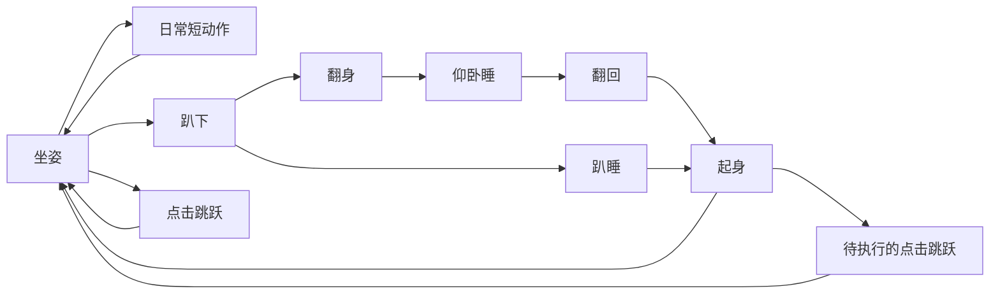

# 安安行为设计

窗口把输入转换为事件，纯 Python 状态机决定顺序，播放器读取 assets/animations.json 的帧路径与时长。动画随程序分发，不在运行时请求图像模型。

1.1.0 起，动作锚点、循环及稳定区域统一写入 `assets/animations.json`；进入、保持、退出阶段和随机权重、冷却统一写入 `assets/behaviors.json`。控制器根据配置安排起卧顺序，播放器按完整姿态的落地点对齐，注视方向切换采用短过渡。详细参数和验证见 [动作配置与衔接优化](动作配置与衔接优化.md)。

1.2.0 起，关注由全局鼠标坐标驱动，鼠标不必停留在猫咪窗口内。以窗口中心为参考，进入半径为宽度的 1.2 倍，退出半径为 1.5 倍；默认大小 220 时分别为 264、330 逻辑像素。内外圈迟滞避免边界反复切换，现有方向死区和方向迟滞继续使用。鼠标静止三秒后结束关注并平滑回正，需要新的移动才重新激活。

## 状态衔接

## 优先级与节奏

- 拖动中断活动，按方向播放走路，松手回稳定坐姿。
- 附近鼠标只改变清醒静止坐姿的注视方向，不跳、不打断睡眠。隐藏、拖动、右键菜单或大小对话框打开时暂停附近关注。
- 关注期间延后随机活动；鼠标静止三秒后结束关注，再经过现有短暂安静期恢复随机调度。重复要求同一种睡姿继续睡，长拖动时走路动画循环。
- 单击跳跃不无限叠加；睡眠或起卧期间收到点击，完成当前过渡并起身后再跳。
- 清醒时约每 18～35 秒选择动作，最近两个动作冷却；安静模式扩大间隔四倍。
- 睡眠保持约 90～240 秒，用两张微动帧表现呼吸；结束后翻回、起身。
- 随机表没有跳跃；旧工作状态仅手动演示，不连接外部软件。
- 散步默认关闭，开启后部分环顾机会改为短距离移动，限制在可见屏幕内。

## 画布与素材

运行帧为 256×256 透明画布。旧帧使用固定偏移，保留腾空高度；新帧用统一比例裁取，以共同底边对齐，避免逐帧改变比例。仰卧参考原照中的白肚皮、蜷前爪、舒展后腿、侧倒头和蓬松棕尾。

四组新分镜由内置 imagegen 生成；源 PNG 本身具有真实透明通道。准备脚本只裁切、缩放、对齐已有生成像素，没有绘制新猫或旋转旧坐姿冒充新姿势。提示、源图、成品帧和预览都保存入库。

1.0.1 的待机和注视共用固定身体，只合成眼部或头部，避免全身纹理变化。十六帧挠耳使用独立的新分镜和共同倍率，以白前爪定位；用户已允许用 Python 保守清除极低透明度杂点。精确计时器每16毫秒检查画面，只有实际画面改变才请求重绘；短过渡使用预乘透明度合成，非循环动作停在末帧。详细根因、测量和复现见 [动画流畅度优化](动画流畅度优化.md)。

1.2.0 保留同一组十六帧挠耳，将逐帧时长加倍，完整动作由 1,255 毫秒放慢至 2,510 毫秒，帧内短过渡由 60 毫秒调整为 120 毫秒。素材准备脚本记录相同参数，重建不会恢复旧速度。该节奏用于体验优化，不作为猫咪行为的生理标准。

## 跨电脑复现

设计、源码、精确依赖、全部静态资源与构建脚本一起版本化。每次主分支成功构建创建独立 Release 标签，成品版本.json 记录源码提交，从而对应设计与实现。

## 1.3.0 趣味会话

`play.py` 管理独立于 Qt 的索食、投放、进食、满足和逗猫会话；`assets/play.json` 保存节奏、气泡与动画引用。既有行为控制器保留，玩法期间暂停普通随机调度，结束后重新安排，不补播旧队列。

索食会话持续至喂食或取消；先交替张嘴、抬爪与观察，之后降低频率。自动触发累计清醒可见活动时间，普通待机、未关注鼠标且明确交互过去五秒才可进入。第一口在低头阶段完成后结算一次冷却；旧会话完成信号无效。菜单和大小对话框暂停当前会话，超过两秒的单次时钟跳变不补播。

点击由现有手势松开判定统一路由：普通状态跳；索食喂一份冻干；进食只提示；逗猫拍棒。拖动先取消，不把松手视为喂食。睡眠中手动玩法沿旧退出路线起身后启动。

`props.py` 以碗后沿、食物、完整猫咪、碗前沿顺序绘制，不扩大猫咪输入矩形。气泡和羽毛棒最多两个固定小装饰窗，穿透输入且不请求焦点；音符、爱心直接绘制，不累积粒子窗口。新九组动作共48张独立透明姿势，不使用待机固定身体遮罩；帧混合40毫秒、切换80毫秒，减少全身姿势过渡双轮廓。

`audio.py` 默认不接触设备；主动开启后使用异步短WAV，同会话最多两次、间隔一分钟。暂停、取消或关闭声音停止播放，缺文件或设备失败不影响视觉会话。真实扬声器试听单独验收。
