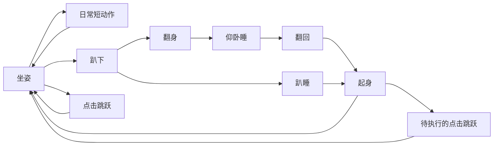

# 安安行为设计

窗口把输入转换为事件，纯 Python 状态机决定顺序，播放器读取 assets/animations.json 的帧路径与时长。动画随程序分发，不在运行时请求图像模型。

## 状态衔接

## 优先级与节奏

- 拖动中断活动，按方向播放走路，松手回稳定坐姿。
- 悬停只改变清醒坐姿的注视方向，不跳、不打断睡眠。
- 单击跳跃不无限叠加；睡眠或起卧期间收到点击，完成当前过渡并起身后再跳。
- 清醒时约每 18～35 秒选择动作，最近两个动作冷却；安静模式扩大间隔四倍。
- 睡眠保持约 90～240 秒，用两张微动帧表现呼吸；结束后翻回、起身。
- 随机表没有跳跃；旧工作状态仅手动演示，不连接外部软件。
- 散步默认关闭，开启后部分环顾机会改为短距离移动，限制在可见屏幕内。

## 画布与素材

运行帧为 256×256 透明画布。旧帧使用固定偏移，保留腾空高度；新帧用统一比例裁取，以共同底边对齐，避免逐帧改变比例。仰卧参考原照中的白肚皮、蜷前爪、舒展后腿、侧倒头和蓬松棕尾。

四组新分镜由内置 imagegen 生成；源 PNG 本身具有真实透明通道。准备脚本只裁切、缩放、对齐已有生成像素，没有绘制新猫或旋转旧坐姿冒充新姿势。提示、源图、成品帧和预览都保存入库。

1.0.1 的待机和注视共用固定身体，只合成眼部或头部，避免全身纹理变化。十六帧挠耳使用独立的新分镜和共同倍率，以白前爪定位；用户已允许用 Python 保守清除极低透明度杂点。精确计时器每16毫秒检查画面，只有实际画面改变才请求重绘；短过渡使用预乘透明度合成，非循环动作停在末帧。详细根因、测量和复现见 [动画流畅度优化](动画流畅度优化.md)。

## 跨电脑复现

设计、源码、精确依赖、全部静态资源与构建脚本一起版本化。每次主分支成功构建创建独立 Release 标签，成品版本.json 记录源码提交，从而对应设计与实现。
